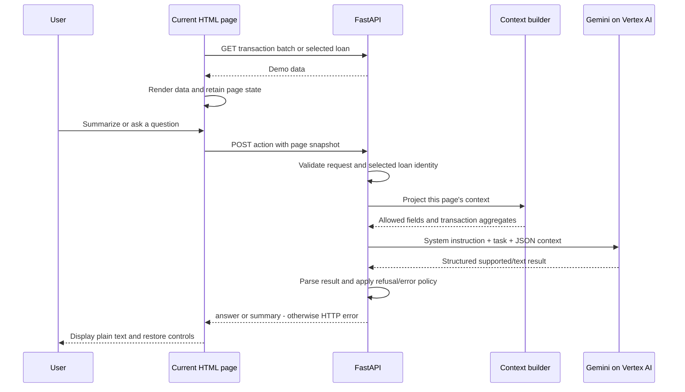

# E-Agent: page-aware financial assistant

An optional **intelligent insights** path now supports personalized suggestions, complete relevant history, follow-up questions and calculated loan ranges. Enable it with `ENABLE_INSIGHTS=true`; it is off by default. See [INSIGHTS.md](INSIGHTS.md) for configuration, data boundaries and the self-contained test harness. The architecture below describes the original page-only flow, which remains the default. The existing submission archive is unchanged.

The seven **Explain** buttons on the dashboard and Credit Details page now provide section-specific explanations with optional Read aloud/Stop controls. This works independently of the insights flag. See [EXPLAIN.md](EXPLAIN.md) for the API, data boundaries, audio behavior and verification commands.

This repository implements **Summarize** and **Ask a Question** on the Transactions (L2) and Loan Details (L2) pages. Its central requirement is that an answer refers only to the information available on the page the user is viewing.

The implementation uses the starter HTML/JavaScript frontend, FastAPI backend, and Gemini through the Google Gen AI SDK. It preserves the four existing chat API contracts. Explain was outside the original submission's scope and is now implemented as the extension documented above; the Loan History (L1) list remains a navigation page rather than a chat surface.

The design separates two concerns: controlling which data reaches the model, and assessing whether the model's answer is faithful to that data. The first has explicit field projections and tests. The second currently relies on prompting and the model's own answerability decision. This document describes both the implemented controls and their limits. **Production Considerations describes proposed work, not capabilities already implemented.**

## Contents

- [Run locally](#run-locally)
- [Architecture](#architecture)
- [Implementation](#implementation)
- [Production Considerations](#production-considerations)
- [Submission verification](#submission-verification)
- [Future production priorities](#future-production-priorities)

## Run locally

Run the following commands from the `embedded-agent` repository directory. Use Python 3.10+ and Node.js/npm. Place the supplied Google service-account JSON at `../creds.json` relative to the repository, or set the environment variable below to its actual path. Credentials must not be included in source control or the submission archive.

### Backend: terminal 1

```bash
cd embedded-agent-be
python3 -m venv .venv
source .venv/bin/activate
pip install -r requirements.txt
export GOOGLE_APPLICATION_CREDENTIALS="$(pwd)/../../creds.json"
uvicorn server:app --reload
```

The backend is available at `http://localhost:8000`; interactive API documentation is at `http://localhost:8000/docs`. The data routes can run without Gemini credentials. Authentication for Gemini is initialized lazily on the first chat request, so successful backend startup does not establish that model access works.

### Frontend: terminal 2

Start from the repository directory in a separate terminal:

```bash
cd embedded-agent-fe
./start.sh
```

The script runs `npx serve . --no-clipboard --no-port-switching --listen 3000`. It may download `serve` on the first run.

| URL | Expected page |
| --- | --- |
| `http://localhost:3000/` | Financial dashboard |
| `http://localhost:3000/transactions` | Transactions and both chat actions |
| `http://localhost:3000/loans` | Loan History list |
| `http://localhost:3000/loan-details?id=LOAN001` | Selected loan and both chat actions |
| `http://localhost:3000/loan-details?id=LOAN004` | Closed-loan example |

The loan page also supports the starter links' `#id=LOAN001` format. Keep the static server's `--single` flag disabled: this is a collection of HTML pages, and that flag previously caused extensionless routes to resolve to the dashboard. Check the rendered page title and widget when testing navigation; HTTP 200 alone does not prove that the correct page was served.

### Configuration

| Variable or setting | Current behavior |
| --- | --- |
| `GOOGLE_APPLICATION_CREDENTIALS` | Path to the service-account JSON; read by Google Application Default Credentials. Never sent to the frontend or included in the prompt. |
| `GOOGLE_CLOUD_PROJECT` | Optional override; otherwise the project is detected from the credentials. |
| `GEMINI_MODEL` | Defaults to `gemini-3.5-flash` in this code. Set it to an appropriate model accessible to the supplied account. |
| `GEMINI_LOCATION` | Defaults to `global`. |
| Frontend `API_BASE` | `http://localhost:8000`, configured in `embedded-agent-fe/config.js`. |

Restart the backend after changing credentials, project, or location: the Gemini client is reused within each process. Requirements currently use unpinned dependency versions; a reproducible production release would lock the versions tested together.

### Local checks

From `embedded-agent-be`, with the virtual environment activated:

```bash
pip install -r requirements-dev.txt
pytest -q
```

The backend suite contains 16 cases and mocks the model. It does not require Google credentials or spend model quota.

With both servers running, run the browser suite from the repository directory using the same activated virtual environment:

```bash
BROWSER_CHANNEL=chrome pytest tests/test_browser.py -q
```

This uses an installed Google Chrome in an isolated headless session. Alternatively, install Playwright's bundled Chromium with `python -m playwright install chromium`, then run without `BROWSER_CHANNEL`. Four browser cases run by default; the live Gemini case is skipped. Browser fixtures are synthetic and deterministic; the navigation test also checks the backend's actual demo responses.

To exercise Gemini through the actual browser widgets and all four chat endpoints, start the backend with valid credentials, then opt in:

```bash
BROWSER_CHANNEL=chrome RUN_LIVE_GEMINI=1 pytest tests/test_browser.py -q -s -k live_gemini
```

The live case makes 12 model requests and prints responses to synthetic financial fixtures. It consumes provider quota. Optional `BROWSER_ARTIFACTS=/tmp/goodscore-browser-artifacts` saves page screenshots. The test's 120-second response wait is a test-runner limit, not an application timeout. See [Testing strategy](#9-testing-strategy) for the evidence and remaining coverage.

## Architecture

### Components and responsibilities

| Component | Responsibility | Source |
| --- | --- | --- |
| Static frontend server | Serves the separate HTML pages and their assets. | [start.sh](embedded-agent-fe/start.sh) |
| Transactions page | Loads transaction batches, renders rows, retains the displayed row data, and submits a snapshot for either chat action. | [transactions.html](embedded-agent-fe/transactions.html) |
| Loan Details page | Loads the selected loan, renders its sections, and projects the fields relevant to that view. | [loan-details.html](embedded-agent-fe/loan-details.html) |
| FastAPI routes | Serve the starter data, validate chat requests, invoke context builders, and map results or errors to HTTP responses. | [server.py](embedded-agent-be/server.py) |
| Context and generation layer | Applies field allowlists, computes transaction aggregates, constructs the prompt, calls Gemini, and parses structured output. | [agent.py](embedded-agent-be/agent.py) |
| Gemini on Vertex AI | Interprets the question or summary request and produces natural-language text plus an answerability flag. | Configured through backend environment variables |
| Tests | Check context projections, arithmetic, API contracts, and selected failure paths. | [test_assistant.py](embedded-agent-be/tests/test_assistant.py) |
| Browser acceptance tests | Check served pages, user interactions, submitted context, and opt-in live Gemini behavior. | [test_browser.py](tests/test_browser.py) |

There is no database, vector index, conversation store, or application response cache. The starter data APIs produce demo data, with randomized transaction rows and payment histories. The backend shares a Gemini client within a process, but it does not retain a user's page context between requests.

### End-to-end data flow



Each chat request that reaches Gemini uses one application-level generation call. It does not re-fetch page data or call another financial endpoint. The SDK may have its own transport/retry behavior; the application does not define a separate retry policy.

### Context consistency and trust boundaries

**Browser to backend.** A snapshot here is a JSON copy of the current page's displayed data, not an image or screenshot. The browser supplies this structured data with each chat request. This avoids a second random data fetch producing different facts during an answer. However, a caller can modify that JSON. Matching `loan_id` against `loan_data.id` is an internal consistency check, not authorization or proof of ownership.

**Backend to Gemini.** The backend reconstructs a smaller context using explicit field allowlists. Unexpected top-level fields and internal transaction identifiers do not automatically enter the prompt. The selected loan ID is checked but omitted from model context. The four routes establish the page type; the request does not choose an arbitrary data source or tool.

**Gemini to browser.** The model returns a structured object that is parsed before the API returns text. The frontend uses `textContent` for assistant output and errors. This prevents the assistant response from being interpreted as HTML, but schema validity and safe rendering do not prove that its financial statements are correct.

The intended page boundary therefore has three different assurance levels:

- Field selection is enforced by application code for the accepted snapshot.
- Snapshot authenticity is assumed in this prototype; it is not verified against an authenticated server-side source.
- Answer faithfulness is guided by a prompt and the model's `supported` flag; there is no independent claim verifier.

### Design decisions and trade-offs

| Decision | Reason | Cost or limitation |
| --- | --- | --- |
| Reuse the existing four endpoints and widgets | Keeps the implementation close to the supplied application and its expected contracts. | The same display rules must currently be maintained in frontend and backend code. |
| Use a page snapshot | The answer sees the same fetched data as the page, despite the random source APIs. | A modified client can forge values; production needs authenticated, versioned snapshots. |
| Project known fields rather than scrape page HTML | Gives the model structured values and avoids navigation, hidden markup, and assistant output becoming context. The loan renderer and request share one normalized object. | Backend projection rules remain separately maintained; changing display rules requires matching regression checks. |
| Compute common transaction aggregates in Python | Makes those calculations exact and independently testable. | Unanticipated calculations over raw rows still lack a deterministic execution path. |
| Use stateless generation | Eliminates retained cross-page conversation context and keeps the serving path small. | Follow-up questions requiring earlier messages are unsupported. |
| Send the demo page directly to Gemini | The complete loaded page is already available; retrieval would add complexity without supplying missing facts. | Context and inference cost grow with the number of loaded rows. |
| Return a fixed refusal for unsupported questions | Gives predictable UI behavior without returning speculative fallback content. | The model still decides when to refuse and can be wrong in either direction. |

## Implementation

### 1. Define what “current page” means

For Transactions, the context consists of **all rows currently loaded into the table**, including rows below the viewport. It does not mean every transaction in the last six months, every transaction held by the backend, or the dashboard's Top Transactions section. The starter endpoint returns 20 rows per request; Load More appends another batch.

The frontend sends `date`, `category`, `merchant`, `type`, and `amount`. Pydantic parses each date, restricts `type` to `debit` or `credit`, and requires a nonnegative integer amount and nonempty category and merchant. Extra row fields, including `id`, are ignored by the request model and absent from its serialized context. Pydantic's normal parsing is used; strict no-coercion validation is not enabled.

The backend derives the following facts from exactly those rows:

```text
debit_total  = sum(amount for rows with type == debit)
credit_total = sum(amount for rows with type == credit)
net_flow     = credit_total - debit_total
```

It also supplies row count, debit totals by category and merchant, and credit totals by category. Amounts in the starter API are interpreted as whole INR units, matching the table. Credits are kept separate from spending; the code does not infer that every credit is income or that an arbitrary credit reverses a particular debit.

For Loan Details, the context is the selected loan, with these projections:

| Page content | Included context |
| --- | --- |
| Title, overview, financial summary | Name, outstanding and original amounts, EMI, total paid, total interest paid, interest rate |
| Common loan information | Type, status, lender, masked account number, disbursement and maturity dates, prepayment charges, late-payment fee |
| Active-loan information | Next due date and tenure remaining |
| Closed-loan information | Closed date and the displayed duration label `Completed`; active-only fields are excluded |
| Additional details | Vehicle make, model, year, registration; otherwise property address, type, and value, following the UI's vehicle-first branch |
| Payment-history table | Month label, due date, paid date, amount, principal, interest, and status for the supplied rows |

The backend requires a matching loan ID, an `Active` or `Closed` status, a truthy `name` value, and a payment-history list whose entries are objects. Payment amounts must be finite numbers or null; strings and booleans are rejected. The `name` check does not enforce a string type. Other loan values remain partially validated dictionaries; the code does not validate every monetary amount, date, required displayed field, or cross-field relationship.

The displayed loan totals are treated as source facts. The payment-history table is partial, so its rows must not be equated with lifetime totals or used to silently “correct” them.

`buildLoanDisplayData` projects and normalizes the fetched loan before either rendering it or retaining assistant context. Payment-history amount, principal, and interest values that are nonpositive or unavailable become JSON `null` and render as `-`; missing paid dates also become null. Positive payment amounts are preserved. A displayed zero in the overview, such as a closed loan's outstanding balance, remains zero. The backend repeats the payment normalization so a caller submitting raw demo values cannot expose a hidden negative or zero payment through that path. The prompt explicitly treats null as unavailable and forbids reconstructing a placeholder from other columns. This fixes the earlier mismatch between the payment table and model context; it does not authenticate client-supplied values or independently verify the model's response.

### 2. Preserve the API contract

| Method and path | Request fields | Successful response |
| --- | --- | --- |
| `POST /transactions/ask` | `question`, `transactions` | `{"answer": "..."}` |
| `POST /transactions/summarize` | `transactions` | `{"summary": "..."}` |
| `POST /loans/ask` | `loan_id`, `question`, `loan_data` | `{"answer": "..."}` |
| `POST /loans/summarize` | `loan_id`, `loan_data` | `{"summary": "..."}` |

An illustrative Transactions request is:

```json
{
  "question": "What is my total spend in the displayed rows?",
  "transactions": [
    {"date": "2026-09-01", "category": "Food", "merchant": "Cafe", "type": "debit", "amount": 100},
    {"date": "2026-09-02", "category": "Travel", "merchant": "Rail", "type": "debit", "amount": 200}
  ]
}
```

The aggregate supplied to Gemini is INR 300. Wording can vary, but the answer should identify that number as spending among the displayed rows. Removing `question` gives the summary request body. Loan requests carry the selected ID plus the page projection described above, including an `id` field for the consistency check.

Questions have a 1,000-character maximum. Empty strings fail model validation; whitespace-only questions are rejected after trimming. There is currently no application limit on snapshot bytes, transaction count, loan-history length, or output tokens.

| Situation | Current API behavior |
| --- | --- |
| Invalid request shape, missing required fields, or invalid typed transaction fields | FastAPI/Pydantic HTTP 422 |
| Whitespace-only question, empty transaction list, mismatched loan ID, or invalid loan context checks | HTTP 400 with a readable `detail` |
| Model returns `supported=false` for a question | HTTP 200 with `{"answer": "That information is not shown on this page."}` |
| Model returns `supported=false` for a summary | HTTP 503 with a grounded-summary error |
| Credential/provider exception, invalid structured output, or supported-but-empty text | HTTP 503 with a generic temporary-unavailability message |
| Supported nonempty result | HTTP 200; outer whitespace is trimmed |

Error handling does not manufacture an answer. The current single 503 category is coarse: a configuration failure, quota issue, and transient provider failure need different recovery actions even though they presently look similar to the user.

### 3. Prompting and model response handling

The system instruction in `generate_grounded_text` establishes the page-only rule, treats context values and the question as untrusted content, forbids external facts and previous conversations, directs transaction answers to use the calculated totals, distinguishes partial loan history from displayed totals, forbids inferring missing placeholder values, and requests concise plain text in INR.

The user content is a JSON serialization of two objects. The following sketch shows the envelope; an actual request includes the nonempty page data:

```json
{
  "task": {"action": "answer the question", "question": "..."},
  "page_context": {"page": "Transactions", "scope": "...", "rows": [], "calculated_from_displayed_rows": {}}
}
```

For summaries, the task contains the summary instruction and no question. Context is structured JSON rather than concatenated HTML. JSON makes the fields unambiguous for the application; it does not turn malicious strings into trusted content.

Gemini is asked for an internal response conforming to `GroundedOutput`:

```json
{"supported": true, "text": "The total spend in the displayed rows is 300 INR."}
```

The adapter accepts a parsed Pydantic object, validates a parsed object, or parses the raw JSON text. It rejects a supported result with empty text. The routes expose only `answer` or `summary`; when `supported` is false for a question, they substitute the fixed refusal regardless of any model-supplied text.

Generation uses temperature `0`, requests JSON output with a response schema, and explicitly disables automatic function calling. No tools or conversation history are supplied. Temperature `0` is a generation setting, not a reproducibility or factuality guarantee. Likewise, `supported` is the model's self-assessment, not a confidence score verified by another system. There is no separate classifier, evidence validation pass, numerical verification of the final prose, or semantic summary-length check.

The cached Gemini client uses backend Application Default Credentials. It is created once per process and reused; this is connection/client reuse, not caching of model answers. Route handlers are synchronous and use the SDK's synchronous generation method. There is no application deadline, cancellation propagation, or explicit inference-concurrency limit.

### 4. Frontend lifecycle

Chat buttons stay disabled until page data is available and while an assistant request is in flight. Blank questions are handled locally before calling the backend. Loading text is replaced by the returned answer or a readable error, and controls are restored in `finally`.

On Transactions, Load More and the chat buttons are mutually disabled during their respective requests. The chat payload copies the currently retained rows, and loading additional rows clears the previous answer. This avoids showing a summary of 20 rows after the table has grown to 40. These flags coordinate one page instance; they are not server-side concurrency or rate controls.

On Loan Details, the selected ID is read from the URL and data is projected according to the active/closed and vehicle/property display branches. The renderer and assistant share the normalized loan object; the assistant is enabled only after rendering completes. Each document load starts a new assistant state. Neither page saves chat history or sends an earlier answer back to Gemini.

Assistant responses and errors use `textContent`, with preserved line breaks. This guarantee applies to the new assistant output. Existing loan-section rendering still uses `innerHTML` interpolation and must be hardened before consuming untrusted production values.

### 5. Assumptions and current boundaries

- The application is a local demonstration with supplied demo records, not an authenticated financial-account service.
- “Available on the page” means the complete loaded page view, including off-screen table rows. It excludes unloaded batches and other pages.
- Transaction amounts are integer INR values. Multiple currencies, minor-unit conversion, refunds, reversals, and settlement semantics are not modeled.
- Starter data is not a stable ledger: re-fetching can change transactions and history. Fixed loan totals, dates, and randomized rows can disagree; the assistant should not infer a missing business rule to reconcile them.
- Loan rendering and submission share normalized values, including `-` placeholders represented as null. Frontend/backend projection rules still need coordinated changes; there is no versioned schema shared across both runtimes.
- Common transaction totals have deterministic computation. Arbitrary filtered arithmetic and loan-history aggregations are not comprehensively computed or verified by the backend.
- “Chat” here is one independent question or summary at a time. A question depending on an earlier answer has no conversational memory to resolve it.
- The strict page-grounding requirement is the target behavior. The current model-only answerability decision and unverified prose do not provide a formal guarantee that every response satisfies it.

## Production Considerations

The following work would be added before serving real customer data. The order of priorities is deliberate: establish trustworthy page context and correct financial semantics before adding throughput optimizations. A faster response is not useful if it describes the wrong page or an unsupported fact.

### 1. Edge cases and data correctness

Extend the frontend's shared loan projection into one versioned display contract enforced by the backend. It should distinguish a known value, a missing value, a value deliberately hidden from the view, and the reason for a display placeholder. This removes the need for separate frontend and backend lists to approximate the same display behavior.

| Case | Current limitation | Proposed behavior |
| --- | --- | --- |
| No transactions or no payment history | The API rejects an empty transaction context; an initially empty transaction response lacks a complete explicit UI empty state. An empty loan-history list is accepted. | Show a stable “no records displayed” state; distinguish valid emptiness from failure to load data. Avoid unnecessary generation calls. |
| Loan values rendered as `-` | These now become null in both the rendering model and assistant context. The original source does not distinguish why a value is unavailable. | Add explicit availability/reason fields to the versioned contract, and enforce them consistently across all nullable fields. |
| Inconsistent fixture data | Independently generated principal can exceed a payment amount, yielding negative interest. Fixed maturity dates and lifetime totals can disagree with generated history. | Validate source semantics and mark contradictions explicitly. Do not let the model invent adjustments or explanations. |
| Partial batch failure or overlapping pagination | Transactions are appended one row at a time; a rendering failure can leave a partial batch. Pagination has no stable snapshot or duplicate-detection contract. | Validate and build a batch before committing it to page state. Use stable record identities and a consistent pagination snapshot; do not deduplicate distinct records merely because their visible values match. |
| Amounts and dates | Transactions have typed dates and integer amounts; most loan fields lack equivalent validation. | Define currency, minor-unit precision, timezone, nullable dates, allowed statuses, and cross-field constraints. Use integer minor units or decimal arithmetic with explicit rounding. |
| Growing tables | Load More can grow context indefinitely, and the demo API has no finite completion signal beyond an empty response. | Enforce byte, row, and token budgets. Offer a clearly labeled smaller view or compute an exact aggregate over the same authorized snapshot; never silently truncate rows while claiming complete coverage. |
| Context changes during generation | Local button disabling handles the current simple page; there is no server snapshot version or stale-response check. | Tag requests and responses with snapshot version and request ID. Cancel or discard results that belong to a prior view. |
| Missing or invalid loan ID | The frontend handles missing IDs, but the starter GET route reports an unknown loan in a JSON error object with HTTP 200. | Use explicit not-found behavior, keep data-loading failure distinct from assistant failure, and never construct context from an error payload. |

For authenticated production data, the backend should create a snapshot containing exactly the authorized display model. The frontend renders that model and submits an opaque snapshot ID for chat. The backend validates its owner, page type, selected loan, version, and expiry, then uses that exact version. Re-fetching the latest records without a version check could recreate the same consistency problem the current browser snapshot avoids.

### 2. Error handling and fallback mechanisms

Use distinct machine-readable outcomes for invalid input, missing page information, unavailable context, and unavailable generation. A page-grounding refusal is an ordinary product result; a provider outage must not be presented as evidence that the page lacks the requested information.

| Failure | Proposed recovery |
| --- | --- |
| Invalid fields or oversized context | Reject before inference with an actionable validation error; do not retry. |
| Unauthorized, expired, or changed snapshot | Reauthenticate or refresh the page context as appropriate. Never substitute another loan or page snapshot. |
| Missing credentials, denied model access, or invalid model configuration | Fail a deployment readiness check and alert the operator. Repeated user retries will not repair configuration. |
| Provider throttling or a transient transport/server error | Allow a bounded retry with backoff and jitter inside the request deadline; respect provider retry guidance. Coordinate with SDK retries to avoid multiplied attempts. |
| Timeout or client navigation | Stop waiting after an application deadline, restore the UI, and cancel downstream work where supported. A disconnected client may still incur provider work, so track cancellation separately. |
| Malformed output, safety block, or failed evidence validation | Return a controlled error or an explicitly supported deterministic fallback. Do not surface an unvalidated partial answer. |

Set an end-to-end deadline and propagate the remaining budget through queueing, provider calls, and any retry. Add a circuit breaker for sustained provider failures and bounded queues for overload. Those controls should be configured from measured latency and quota behavior; no latency objective has been measured or enforced in this prototype.

A useful fallback is a template that reports already validated transaction counts and totals with the exact page scope. It could also report a directly requested loan field when that field is unambiguously available. Such a fallback should be labeled and tested as a separate answer path. It must not expand into financial advice, stale answers from a different snapshot, or an untested alternate model. No deterministic answer fallback currently exists; today the application reports the failure.

### 3. Security and privacy

The current service has no user authentication or per-account authorization. The starter CORS configuration permits all origins, methods, and headers. Restricting CORS would narrow browser access, but it would not authorize API callers or prevent direct HTTP requests.

Before using customer data:

- Authenticate callers and enforce ownership and tenant scope for every data read, snapshot lookup, and cached answer. A client-supplied loan ID cannot be the authority for that check.
- Build context from the authenticated display snapshot. A valid field name and a matching pair of IDs do not establish that the supplied value is authentic.
- Replace broad CORS settings with an explicit frontend-origin policy. If cookies are introduced, design the session and CSRF controls together.
- Replace remaining loan-section `innerHTML` interpolation with safe DOM construction or a reviewed escaping strategy. Safe assistant rendering does not secure the rest of the page.
- Use least-privilege service identity, separate environments, and managed credentials where the deployment supports them. Restrict model access independently of financial data access and rotate any leaked key.
- Apply explicit data-minimization and retention rules. A property address, registration number, or masked account identifier can still be sensitive. Decide what can be sent to the model, where processing may occur, and how retained snapshots or diagnostics are protected and deleted.

The application log currently records the exception class for generation failures rather than intentionally logging prompts. That is a narrow property of this code, not a reviewed privacy guarantee across SDK, infrastructure, access logs, and monitoring systems.

### 4. Prompt injection prevention and factual grounding

Treat the question, merchant labels, loan fields, and any future imported text as untrusted inputs. A malicious string can be a legitimate-looking field value while also trying to override the assistant's instructions. Field allowlists, JSON serialization, and a schema for the response do not make that content safe on their own.

Current controls are a system instruction separating policy from data, explicit page projections, no retained conversation, no supplied tools, and plain-text response rendering. They limit exposure and available actions. They do not establish a complete prompt-injection defense or prevent unsupported prose.

A stronger design would:

1. Establish authorized, versioned context before involving the model; reject extra context sources, URLs, and cross-page lookups at the application boundary.
2. Represent relevant facts with stable references to fields, rows, or deterministic calculations. Ask the model to identify supporting references for each material claim.
3. Check that the references exist in this snapshot and that the claimed value, unit, entity, and relationship agree. Finding the same number somewhere in the context is not sufficient evidence.
4. Execute arithmetic through a constrained, validated calculation path over the snapshot. Never run generated Python or SQL directly. For common high-assurance answers, render the verified fact through a template.
5. Refuse or fall back when support cannot be verified, and test that the mechanism does not over-refuse straightforward questions that the page can answer.

A second model used as a judge can help evaluation but is not an authorization boundary and can share the generator's failure modes. Similarly, adding citations does not prove truth if their relationship to the claim is unchecked. The useful target is evidence that an application can validate, with clearly stated limits for open-ended prose.

### 5. Performance optimizations

With `n` displayed transaction rows, context construction and the current aggregate pass are O(n). The prompt also contains those rows, so repeated questions resend substantially the same data. Loading more rows increases serialization, network, token, and model-processing costs even if the question is short.

Measure context size, token usage, provider latency, and total request latency separately before selecting optimizations. Then:

- Set input and output budgets and avoid repeated field labels or irrelevant metadata where they do not improve answer quality. Preserve page scope and all facts needed by the question.
- Route common exact calculations through deterministic code; keep the model responsible for interpretation and explanation where it adds value.
- Use an asynchronous provider client with explicit concurrency bounds if model wait time becomes the limiting factor. Merely changing the route to `async def` while keeping a blocking SDK call would not solve that problem.
- Reuse clients and connections, and avoid doing expensive credential or context initialization per request where it can safely be reused.
- Consider streaming only with a plan for validation. Showing unvalidated financial claims token by token conflicts with checking the complete structured result before display.

If the context exceeds a budget, do not silently replace the page with a sample and present the answer as complete. Exact aggregate queries can run over the full snapshot, while questions needing individual rows may require a narrower, visibly defined page view.

### 6. Caching strategies

There is currently no response caching. `_gemini_client` is memoized to reuse a client object; it does not store answers.

For future summary caching, the key must bind the result to the authorized user/tenant, page type, selected loan where applicable, exact display-snapshot version or digest, action, prompt and schema versions, model configuration, currency, and locale. Question answers additionally require the exact question or a normalization proven not to change its meaning. Avoid approximate semantic cache matches for financial questions unless correctness and scope can be established independently.

Authorize the snapshot before looking up a cached answer. Use deterministic serialization for the digest while preserving meaningful row order, keep raw sensitive fields out of cache keys, and treat hashes as potentially sensitive metadata. Invalidate on permission changes and snapshot or prompt changes; a TTL alone does not ensure freshness or authorization. Do not cache transient failures as answers. Cache only validated outputs, and coalesce identical in-flight work only within the same authorized context.

### 7. Rate limiting and resource protection

Disabled UI buttons reduce accidental repeats in one tab. They do not prevent scripts, multiple tabs, or many users from exhausting shared provider quota.

Enforce request and token budgets per authenticated user and tenant, an overall provider quota budget, and separate limits on concurrent inference. Estimate request weight from snapshot size so that a large table is not treated as equivalent to a short field lookup. Bound queued work and fail excess requests predictably with a retry interval instead of allowing unbounded memory growth or waiting.

For multiple API workers, coordinate shared quotas through a shared limiter or gateway; a per-process counter multiplies the effective limit as replicas increase. Authentication and context validation should precede costly inference, and retries should consume the same budget as their original request.

### 8. Monitoring and observability

Current observability consists of normal server/access logs and a warning containing the exception class when generation fails. There are no application-level request IDs, latency histograms, model-usage dashboards, traces, or quality alerts.

Add correlated spans for validation, snapshot lookup, context preparation, queue wait, provider inference, and response validation. Keep the model and prompt/schema versions attached to the request so that regressions can be attributed to a release.

| Signal | Why it matters |
| --- | --- |
| Requests and errors by page/action and error class | Separates broken context loading, invalid requests, configuration problems, and provider incidents. |
| End-to-end and provider latency distributions | Shows whether time is spent in the application, its queue, or inference; averages hide slow-tail behavior. |
| Context bytes/rows, input/output tokens, and usage cost | Detects oversized pages, unexpectedly verbose answers, and cost regressions. |
| In-flight requests, queue depth, throttling, and retry counts | Reveals saturation before it becomes a broad availability issue. |
| Schema failures, evidence failures, refusals, and stale-result discards | Tracks behavior of the answer-validation boundary. |
| Offline grounding and answerability results by release | Distinguishes a model-quality regression from an operationally healthy service. |

A high refusal rate can mean successful scope enforcement or an assistant that refuses valid questions. It needs labeled evaluation, not an alert based only on request counts. Default logs should contain operational metadata rather than questions, financial records, model answers, credentials, or access tokens. Any content sampling for incident review needs an explicit access, redaction, retention, and deletion policy.

### 9. Testing strategy

**What is included today.** The 16 backend pytest cases cover exact transaction totals and removal of extra fields; active/closed loan projection, conditional additional details, and hidden history fields; payment placeholder normalization, preservation of valid amounts and overview zeroes, and rejection of invalid payment values; four API response contracts; fixed refusal mapping plus selected invalid-context cases; and a provider exception mapped to 503. The model call is mocked. In particular, the refusal test proves what happens when the model says `supported=false`; it does not prove that Gemini will recognize every unsupported question.

The separate Playwright suite contains four default browser cases and one opt-in live case. It covers dashboard and loan-list navigation, extensionless URLs, query/hash loan IDs, actual demo-data rendering, both widgets, active/closed field visibility, placeholder values in outgoing requests, 20-to-40-row pagination, stale-answer clearing, blank questions, fixed refusals, 503 recovery, and plain-text assistant output. Default assistant responses are stubbed deliberately so these checks are repeatable without model access.

The live case keeps deterministic page-data fixtures but sends chat requests through the real FastAPI backend and Gemini. It checks transaction summary facts, debit totals before and after Load More, an unavailable credit score, summaries and lifetime-interest answers for active and closed loans, cross-page refusals, and refusal to reconstruct a hidden payment-interest value. It also checks that controls are disabled during inference and restored afterward. This is a small acceptance sample, not a repeated model-quality benchmark or evidence of a production accuracy/latency objective.

**What should be expanded before a production release.** Build on these fixtures with independently specified expected facts and a fixed clock where dates matter:

| Layer | Important cases |
| --- | --- |
| Context and arithmetic | Empty and large snapshots, boundary amounts, duplicate versus distinct records, refund semantics, exact filtered calculations, closed-loan fields, and placeholders that must not expose raw numbers. |
| Adapter and API | All parsing paths, missing/invalid model output, supported-but-empty answers, credential failures, quota errors, timeouts, retry deadlines, authorization failures, and expired snapshot versions. |
| Real browser | Correct titles and widgets at `/transactions` and `/loan-details`; dashboard and loan-list navigation; ID query/hash handling; data readiness; loading/error recovery; Load More changing 20 rows to 40 and clearing the old answer; safe rendering of hostile strings. |
| Security and isolation | Cross-user snapshot IDs, altered loan IDs, extra fields, injected instructions in questions and record values, cache isolation, and stale responses after a view change. |
| Model behavior | Exact field questions, concise summaries, arbitrary supported wording, absent facts, references to another loan/page, general-advice requests, contradictory data, and adversarial combinations. |
| Load and resilience | Concurrent large snapshots, slow or unavailable inference, provider throttling, retry amplification, cancellation, and recovery after saturation. |

For model evaluations, compare claimed facts, numbers, units, entities, and scope to a reference snapshot; avoid asserting one exact sentence. Measure factual correctness, unsupported claims, cross-page contamination, false refusals, and summary coverage separately. Keep adversarial and ordinary examples, hold out some cases from prompt iteration, and rerun across model/prompt changes. Automated or model-assisted grading should be calibrated against human review for cases that deterministic checks cannot settle.

Before promoting a release, require deterministic fixtures and isolation tests to pass, investigate every unauthorized-context disclosure, and reject known numerical regressions. Establish explicit acceptance thresholds for supported-question answerability, summary coverage, latency, and cost using representative evaluations. A passing finite test set is evidence for that set, not a proof that the model can never hallucinate.

### 10. Scalability and release discipline

FastAPI workers can share a stateless HTTP contract, but provider quota, in-flight model calls, and snapshot access will constrain throughput before the small context-building functions do. Synchronous generation ties up a worker thread while waiting; thread-pool capacity is not a substitute for deliberate admission control.

A production deployment would separate static asset delivery from API workers, keep authorized versioned snapshots in a shared store, and coordinate rate limits and any answer cache across replicas. Snapshot reads must remain consistent with the view the user saw. Replica-local conversation state or caches must not become accidental sources of context leakage or inconsistent behavior.

Package tested dependencies, version the context schema and prompt alongside the model configuration, and run contract plus grounding evaluations before promotion. Roll out changes to a limited cohort while comparing latency, cost, failures, and quality signals, with the prior application and configuration available for rollback. Changes to model, prompt, display projection, or permissions must also invalidate incompatible cached results. Additional infrastructure should follow measured bottlenecks rather than precede a trustworthy data boundary.

## Submission verification

The assignment's submission checks are the mandatory Transactions and Loan Details actions, page-specific context, and the architecture/implementation/production documentation. The optional Explain/audio work is excluded.

Verification completed on 2026-09-19:

| Check | Result |
| --- | --- |
| Backend unit/API suite | 16 passed; Gemini mocked |
| Default browser acceptance suite | 4 passed in headless Chrome; includes real navigation and actual backend demo-data rendering |
| Opt-in live browser case | Passed all 12 Gemini request checks across Transactions and active/closed Loan Details |
| Visual inspection | Inspected captured loan-widget pages, including the closed-loan placeholder refusal |

These results apply to the tested fixtures and local configuration. The live check is intentionally opt-in because model availability and behavior can change independently of the code.

- Payment-history placeholders now have the same meaning in the rendered view and model input, with backend and browser regressions.
- The repeatable backend and browser checks are documented under [Local checks](#local-checks). Run the live case when credentials/model configuration change.
- The following roadmap describes production work beyond the take-home requirements. Its absence is documented explicitly; it is not a claim that the prototype already provides production authentication or guaranteed model faithfulness.

## Future production priorities

| Order | Next work | Evidence required before moving on |
| --- | --- | --- |
| 1. Establish correct and authorized context | Extend the shared loan projection into a versioned display contract, strict loan validation, authenticated snapshots, and safe rendering of source fields. | The model context matches the authorized rendered view, including nulls and conditional fields; tampered or cross-user context is rejected. |
| 2. Make answers and failures reviewable | Broader deterministic calculation paths, evidence checks, distinct error outcomes, deadlines, cancellation, and expanded browser/grounding coverage. | Correct financial fixtures, predictable refusal and recovery, and no regression in actual page navigation or widget behavior. |
| 3. Operate within measured budgets | Usage metrics, concurrency and rate limits, exact-snapshot caching where useful, locked releases, and gradual rollout. | Measured quality, latency, and cost meet agreed thresholds under representative traffic and failure conditions. |

The design decision to defend in a follow-up discussion is the page snapshot: it solves an immediate consistency problem in the supplied code, while creating an explicit trust assumption that must be replaced before production. The next decision is to separate deterministic facts from generated explanation. Those boundaries make the implementation small enough to understand and its remaining risks specific enough to test.
